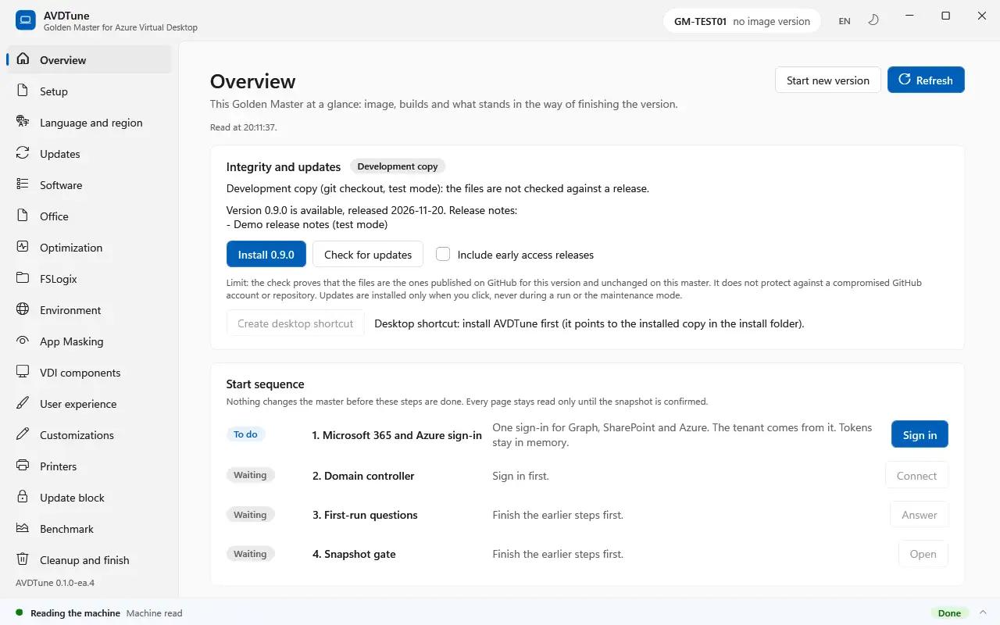

# AVDTune

Golden Master management for Azure Virtual Desktop: setup, updates, update block for users, optimization, benchmark, watermark, cleanup and finish, protocol and change log. Runs locally on the Golden Master. Same look as PackTune.

The tour and the screenshots in `docs/screenshots` come from the GUI smoke test with demo data (fake machine, fake sign-in and fake Azure; `Tests\Record-Demo.ps1`).

Status (November 2026): every page of the plan is built except **Setup** (the guided order of phase 6 is still a placeholder; its parts are the pages below); phase 7 adds the export, the housekeeping of old snapshots and this tour. What still needs a real test VM or is open is named in `docs/plans/avdtune.md` and in the page documents below.

## Pages

- **Overview**: start sequence (sign-in, domain, first-run questions, snapshot gate with name confirmation), image version, readiness analysis, integrity and updates of AVDTune, rollback hint.
- **Language and region**, **Office**, **VDI components**, **Optimization**, **User experience**: the setup of the master in a fixed order, each step with Test/Apply/Undo, its reason and source.
- **Updates** and **Update block**: Windows, Office, Edge, Teams, OneDrive, FSLogix, Defender and software updates; updates hidden for users with a maintenance mode.
- **Software** (library, winget, Chocolatey, custom software with recording), **Customizations** (shortcuts, fonts, web apps, own steps), **Printers** (drivers from a print server).
- **FSLogix**, **Environment** (storage account, share, private endpoint, identity), **App Masking** (rules with groups of the domain, Public Desktop).
- **Benchmark**: baseline and every image version, comparison per version, benchmark-only mode.
- **Cleanup and finish**: healthcheck, cleanup, tokens removed, version closed; the image is then made from a copy by the imaging tool (Hydra for Azure Virtual Desktop or another one). The master is never sysprepped.
- **Protocol and change log**: session protocol, change log per image version with notes, SharePoint of the environment, export and old snapshots.

## Export and old snapshots (phase 7, issue #91)

On the Protocol page, change log view:

- **Export (ZIP)**: the environment document, `environment.json`, the change log of every version (JSON and Markdown), the benchmark comparison, the customizations, printer drivers and App Masking rules in one ZIP (`Modules/AVDTune.Export.psm1`). Every file passes the secret table of `AVDTune.SharePoint` (JSON values whose name sounds secret are left out, a file in which the table still finds something is left out and named in `README.txt` of the ZIP). Written to `<state>\exports` or a chosen local folder: no part of the path may be a link, the ZIP is written to a new temp file and moved over the target in one step. An export is not imported again (not in the plan).
- **Old snapshots of the OS disk**: "Read snapshots" lists the snapshots of this OS disk with the reason why each one stays or can go, reads the image versions of the chosen gallery image definition and records new ones (made by the imaging tool after a finish) in the change log of the finished version (gallery version, date, regions). A snapshot can go only when it is finished, not the confirmed snapshot of the gate, not the snapshot of the running image version, made by AVDTune (tag `CreatedWith=AVDTune`) or named by the snapshot name pattern, not one of the newest N, older than the minimum age (settings, default 2 and 7 days) and older than an image version of the gallery. "Delete marked snapshots" asks with the list of names, needs the open snapshot gate and an open image version, reads everything from Azure again, deletes only those names and writes one change log entry each. Without the right `Microsoft.Compute/snapshots/delete` (role Disk Snapshot Contributor or Contributor) Azure's 403 is shown with the missing right and nothing else is tried.

## Layout

- `Start-AVDTune.ps1`, `UI/AVDTune.xaml`: the window (needs Windows PowerShell 5.1 and administrator rights).
- `Modules/AVDTune.psm1`: engine without UI (machine adapter, state, step contract, change log, Overview data, write gate).
- `Modules/AVDTune.Start.psm1` (first-run questions, environment.json, start stages), `AVDTune.Session.psm1` (sign-in, tokens in memory), `AVDTune.Snapshot.psm1` (VM identity, snapshot, gate), `AVDTune.Directory.psm1` (domain controller over LDAP): the start sequence, see `docs/start-sequence.md`. `AVDTune-Start.ps1` is its part of the window.
- `Modules/AVDTune.Readiness.psm1` and `readiness.json`: the readiness analysis (is the master ready for the v6/v7 VM sizes, and clean enough to become an image). Read only; the criteria are data, each with its Microsoft Learn source, the date it was read and whether Learn really states it (what it does not state is marked "not verified"). Green, yellow, red per check, "not checkable" when Azure cannot be read; red blocks "Abschliessen", yellow needs a confirmation that names every item. `AVDTune-Readiness.ps1` is its card on the Overview. Keep `readiness.json` current: new VM sizes come often.
- `Modules/AVDTune.FSLogix.psm1`, `AVDTune.Storage.psm1`, `AVDTune-FSLogix.ps1` (the FSLogix page): install and update from Microsoft with the signature check, profile settings with Microsoft's recommended values and reasons, include/exclude lists, redirections.xml, Defender exclusions, the function test (part of the healthcheck) and the storage check through the Azure sign-in. Sources and what is not verified: `docs/fslogix.md`.
- `Modules/AVDTune.Software.psm1`, `AVDTune-Software.ps1`, `UI/Software.xaml` (the Software page, issue 31): what is installed (Uninstall keys), search, install, update and remove through winget and Chocolatey, and the PackTune library (the SharePoint package store, read only, installed only when Intune carries the manifest hash; MSI packages). Every call runs in the lock `Global\PackTune`, with the full path of a signed program held open during the run, behind the write gate, with change log entry and run record; long runs are tasks on the task bar. Not yet: the recording wizard for own software, web apps, printers, fonts (later issues of phase 4).
- `Modules/AVDTune.Vdi.psm1`, `AVDTune-Vdi.ps1`, `UI/Vdi.xaml` (the VDI components page, issue 56): new Teams for VDI, the WebRTC Redirector Service, multimedia redirection and OneDrive per machine: detection with pills, install/update/remove from Microsoft (entry links followed by hand, fixed hosts, signature, file held until the start), recommended registry settings with undo. Sources and what is not verified: `docs/vdi-components.md`.
- `Modules/AVDTune.Custom.psm1`, `AVDTune-Custom.ps1` (the Customizations page, issue 85, plan 3d): shortcuts on the Public Desktop and/or in the Start menu (target, arguments, working folder, also UNC, icon from the target or the library, App Masking for who sees it), fonts for all users from the library, and own steps without code (HKLM registry value, ini value, hosts entry, folder with permissions, file or script from the library). Each item is a step with Test/Apply/Undo through the engine (write gate, change log, undo record); library files come from `AVDTune-Assets\manifest.json` of the PackTune store and are pinned by SHA256. Library scripts get `-AVDTuneMode Test|Apply|Undo` and answer with exit code 0 (in place / done) or 1 (missing).
- `Modules/AVDTune.WebApp.psm1` with the kind "Web app" of the Customizations page (issue 88, plan 3a): name, https start URL, optional manifest id and app id, window mode, shortcut on the Public Desktop and/or Start menu, icon from the library (pinned SHA256), App Masking. Edge installs the app through `WebAppInstallForceList` (only AVDTune's own entries change, undo puts the old value back); the shortcut starts `msedge_proxy.exe --app-id` when the app id is known, else `msedge.exe --app` with its own AppUserModelID. What the VM spike still has to confirm: `docs/webapps.md`.
- `Modules/AVDTune.Recording.psm1`, `AVDTune-CustomSoftware.ps1` (card "Custom software" on the Software page, issue 87, plan 3e, first stage): the installer (.msi or .exe) comes from the library `AVDTune-Assets` with its SHA256 pinned by the form; it is staged in a new admin-only download folder, held open and checked against the pin, its signature read (a broken one stops it, unsigned is recorded), and started inside `Global\PackTune`, in a job object with a timeout (an .msi through the checked msiexec). Before and after, AVDTune records programs (uninstall keys), files (Program Files, ProgramData, Public Desktop), HKLM\SOFTWARE keys, services and drivers and the shortcuts, read only and bounded; the record (`<state>\software\custom\<app>\<nnn>\record.json`, `documentation.html`) holds the changes, a detection rule, the silent and uninstall command. Licence notes are cleaned of keys and passwords. "Record update" keeps the history of an app. Not yet: step images, notes window, processes, PDF, SharePoint, watched source.
- `Modules/AVDTune.Printers.psm1`, `AVDTune-Printers.ps1` (the Printers page, issue 86, plan 3b; only with a domain, Entra only points to Universal Print): print servers only from AD (pinned LDAPS), read over WinRM with Kerberos (FQDN, the domain account as UPN; no NTLM, no TrustedHosts); every driver of the selected printers comes by an export of only that driver, checked (limits, no links, catalog signature: WHQL or a publisher the administrator allowed in `config\printers-signers.json`), and is installed with pnputil and Add-PrinterDriver from the confirmed plan (a server that answers differently or a changed signer stops it); Point and Print policies with undo and a hint on unsafe values; each driver checked against the server version and the driver store and logged with server, signer and printers. The Updates page shows new and changed drivers of the last read.
- `Modules/AVDTune.SharePoint.psm1`, `AVDTune-SharePoint.ps1` (card on the Protocol page, change log view, issue 89): the change log goes to the list "AVDTune Change Log" of the SharePoint site of the environment (created with fixed columns, only entries the list does not have yet), the recorded custom software and the installed programs to the list "AVDTune Software" with the documentation and record of every recording in the folder `AVDTune\<version>` of the document library, and the environment document (HTML, also saved in `<state>\documents`). Microsoft Graph only, with the Sites token of the sign-in (Sites.Selected with write on that site); nothing that looks like a token, password or key is uploaded. Local records whose upload SharePoint still confirms (size and hash) can be removed before the finish. **Make the site readable for administrators only**: the environment document names Azure resources, the domain and OU, print servers and user names. Without a site everything stays local.
- `AVDTune-Theme.ps1`, `AVDTune-Protocol.ps1`: AVDTune's own layer on top of the shared PackTune code.
- `AVDTune-UiText.ps1`, `UI\Strings.en.json`, `UI\Strings.de.json`: the language of the window (EN/DE switch in the title bar, saved like the theme; the protocol follows the same switch). The files are data (flat JSON, string values only, keys `[a-z0-9.]+`); English is the fallback. In XAML an element gets its texts through its `Uid` (`<uid>` text, `<uid>.tip`, `<uid>.name`), in code through `Get-AVDTuneText 'key' args` (alias `T`). Pages that are not translated yet keep their English texts.
- `Modules/AVDTune.Export.psm1`, `AVDTune-Export.ps1` (cards on the Protocol page, issue 91): the export ZIP and the housekeeping of old snapshots (the logic of the snapshots in `AVDTune.Snapshot.psm1`).
- `Shared/`: copies from PackTune, never edited here. `Tools\Sync-FromPackTune.ps1` copies them and writes `Shared/SOURCE.json` (PackTune commit, SHA256 per file). Change shared code in PackTune first, then sync.
- `Modules/AVDTune.Release.psm1`, `AVDTune-Release.ps1`, `VERSION`: integrity check, update check, update, repair and rollback against GitHub releases (card "Integrity and updates" on the Overview), see Releases below. `Tools\New-AVDTuneRelease.ps1` and `.github/workflows/release.yml` build a release.
- State on the master: `C:\ProgramData\AVDTune` (Administrators and SYSTEM only).

## Releases, integrity and updates

A release is made by the workflow `.github/workflows/release.yml` when a tag `vX.Y.Z` (stable) or `vX.Y.Z-ea.N` (early access, marked as pre-release) is pushed on a commit of `main` whose file `VERSION` says the same version. The workflow runs `Tests\Check-All.ps1` (including `Check-PublicContent.ps1`), builds `AVDTune-<version>.zip` and `manifest.json` with `Tools\New-AVDTuneRelease.ps1` from the clean checkout and attaches both to the release. The manifest holds version, commit, date, release notes, size and SHA256 of the ZIP and of every file. Not in the ZIP: `.claude`, `.github`, `Tests`, `Tools`, `docs`, `CLAUDE.md` (the master has no use for them, and every file in the ZIP is one more to verify). The ZIP is reproducible: the same commit gives the same ZIP.

The workflow has a read-only build job and a separate publish job with write permission, takes the tag name only from the environment (never into a script text) and checks it against `vX.Y.Z` / `vX.Y.Z-ea.N` first. Recommended in the repository settings: a tag protection rule (ruleset) for `v*`, so only maintainers can create release tags, and protection of `main`.

On the master the tool lives side by side in `C:\Program Files\AVDTune\<version>` (administrators only). `current.json` there names the version that the launcher `C:\Program Files\AVDTune\Start-AVDTune.ps1` starts, and the one before it; switching and going back is one atomic write of that file, and a shortcut to the launcher never changes. The first install is by hand: unpack the ZIP of a release anywhere and start `Start-AVDTune.ps1` from it (the card says "not protected" and offers the install into Program Files), then use the launcher.

- At every start AVDTune compares its files with the `manifest.json` of its own version (from GitHub over HTTPS, TLS 1.2, only `github.com` and the hosts GitHub redirects downloads to; the copy saved at install time when GitHub cannot be reached). Missing, changed or extra files (and links) make the card red with the file list; AVDTune is then read only (the write gate stays shut) until "Repair" has downloaded the release again, checked it and put the files right, and AVDTune was started again. A git checkout counts as "development copy" only in test mode (with the fake machine); anywhere else it is an unprotected copy. A folder directly below the install folder is always checked, whatever it contains: its version is its folder name, a different `VERSION` or a `.git` inside count as changed or extra files, and so does a launcher that is not what AVDTune writes. The install folder itself must be administrators only (owner, no write access for others, no links), else AVDTune stays read only. Without a manifest from GitHub and without a cached one AVDTune stays read only until the manifest can be loaded; "Continue without check" needs the typed computer name and is written to the protocol and the change log. A copy outside the install folder stays read only when users without administrator rights can change it (then only "Install" is offered); a copy with administrator-only rights may run, with a note.
- The update check looks for the newest stable release (early access only when switched on in the card) and shows its release notes. An update is installed only on a click, never during a run or the maintenance mode: ZIP and manifest are loaded, the SHA256 of the ZIP and of every file is checked (nothing missing, nothing extra, no path outside the target), the version is installed next to the running one and switched; the previous version stays and "Back to the previous version" switches back. Every step goes into the protocol and the change log (every change log entry carries the tool version).
- After "Cleanup and finish" the image version is closed (#50): every change of the master is locked, and so are installing, repairing or going back to another version of AVDTune itself (it would land in the closed image). A self-update is possible again after "Start new version" on the Overview; only the crash repairs (interrupted finish, maintenance mode, benchmark) still run.
- Module path (#73): the launcher and `Start-AVDTune.ps1` set `PSModulePath` to `System32\WindowsPowerShell\v1.0\Modules;Program Files\WindowsPowerShell\Modules` as their first statement, before any cmdlet runs, so no module from the admin's `Documents` or from `HKCU\Environment` is loaded (also not for `Join-Path` or `Get-Content`); every worker and every child process gets the same path. At the start AVDTune checks these folders, the folders above them and everything in their module folders (versions and sub folders like `bin`, up to 5000 entries per module path folder; links are not allowed, more entries are a finding) and that Windows PowerShell would keep the path when a runspace opens; otherwise it does not start. The launcher of an AVDTune before this change counts as a changed launcher (read only, the card says "Repair now") until "Repair" or the next update through AVDTune writes the new one; until then it still runs `Join-Path`, `Get-Content` and `ConvertFrom-Json` before the safe path is set. A copy that is not updated through AVDTune (unpacked or deployed by hand) keeps its old launcher: click "Repair" on the Overview right after the first start of the new version. Remaining risk: a profile runs before any script. Start AVDTune through its shortcut or with `powershell.exe -NoProfile -ExecutionPolicy Bypass -File ...`; an administrator console opened by hand with its profile has already run the admin's own code.
- Limit: the hash manifest proves that the files are the ones published on GitHub for that version and unchanged on this master. It does not protect against a compromised GitHub account or repository (whoever can publish a release can publish a matching manifest), and the check runs inside the tool it checks. Authenticode signing can be added later without changing the flow; the publisher would then be pinned as well.

`Tests\Check-PublicContent.ps1` keeps the public repo clean: it fails on GUIDs outside `Tests\` that are not on its list of public IDs, storage account host names (`*.file.core.windows.net`) with a real name, IP addresses outside the documentation ranges (`192.0.2.0/24`, `198.51.100.0/24`, `203.0.113.0/24`), and on every name in the local deny list `%LOCALAPPDATA%\AVDTune\deny-list.txt` (one name per line, never committed; without it the check only notes that names were not checked). It also fails on e-mail addresses and UPNs, `*.onmicrosoft.com`, `*.sharepoint.com`, `*.blob.core.windows.net`, `*.vault.azure.net` with a real name (placeholders like `contoso` and `example` are fine), IPv6 addresses outside `2001:db8::/32`, and on GUIDs inside `Tests\` too (obvious fakes like `11111111-2222-...` are fine). A line with `public-content-ok: reason` is skipped; the reason is required. Not covered: images (screenshots, the animated preview) and commit messages; check those by hand before something goes public.

## Checks

Run from Windows PowerShell, or from Git Bash with `env -u PSModulePath powershell.exe -NoProfile -File ...`:

- `Tests\Check-All.ps1` runs all fast checks (`-Smoke` adds the GUI smoke test).
- `Check-Shared.ps1`, `Check-AVDTune.ps1`, `Check-Readiness.ps1`, `Check-FSLogix.ps1`, `Check-Storage.ps1`, `Check-Software.ps1` (search, install, update, remove and the library against the fake package store and fake winget/choco), `Check-Custom.ps1` (customizations: validation, Test/Apply/Undo of every kind, re-apply after a rollback, library files pinned by SHA256), `Check-WebApp.ps1` (web apps: URL rules, Edge policy list merge and exact undo, launch of the shortcut), `Check-Start.ps1` (start sequence against the fakes in `Tests\Fakes\FakeServices.ps1`), `Check-Protocol.ps1`, `Check-Theme.ps1`, `Check-UiText.ps1` (language files: same keys and placeholders, typed loader, fallback, no fixed text in the translated shell), `Check-Release.ps1` (release script, integrity, update, repair, rollback against a fake HTTP adapter and temp folders), `Check-PublicContent.ps1`, `Check-Export.ps1` (export ZIP, secret filter, path without links; snapshot housekeeping and gallery versions against the fake ARM); `Invoke-GuiSmoke.ps1` drives the window off-screen with a fake machine and a temporary state folder.

`Tests\Record-Demo.ps1` makes the tour (`docs/screenshots/demo.webp`) and the screenshots from a smoke run; it needs `img2webp` from libwebp (`winget install Google.Libwebp`). The pictures show demo data only; check them by hand before a commit (the public content check does not read images).

Checks use fakes only. Real runs belong on a throwaway Windows 11 multi-session VM, never on a developer machine.
